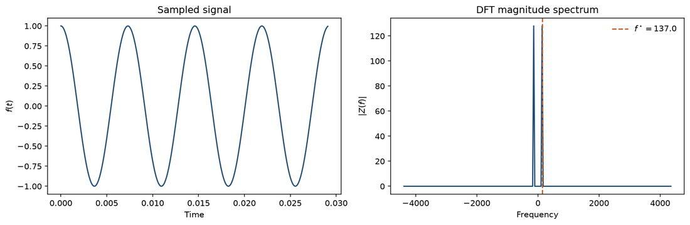
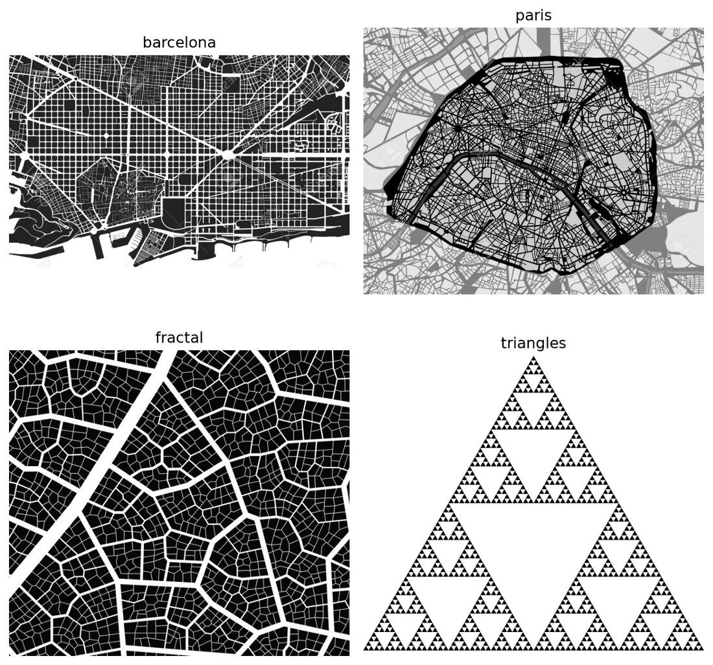
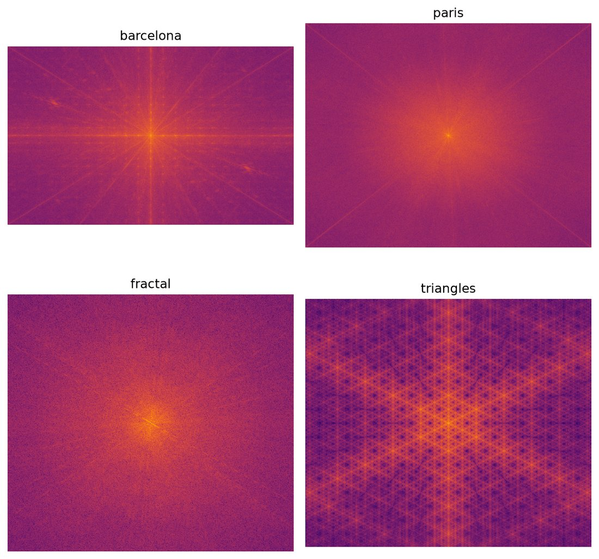
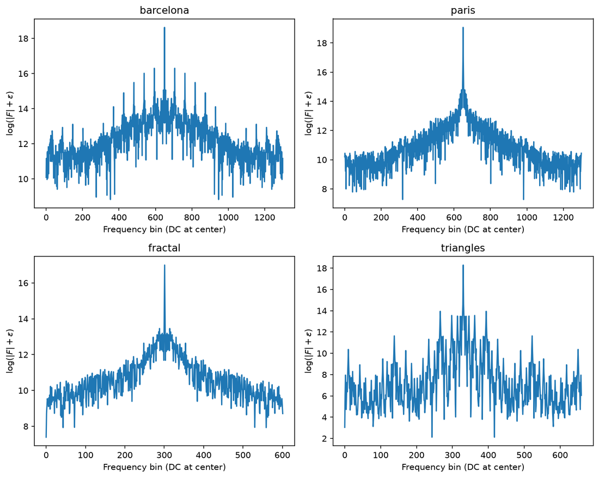
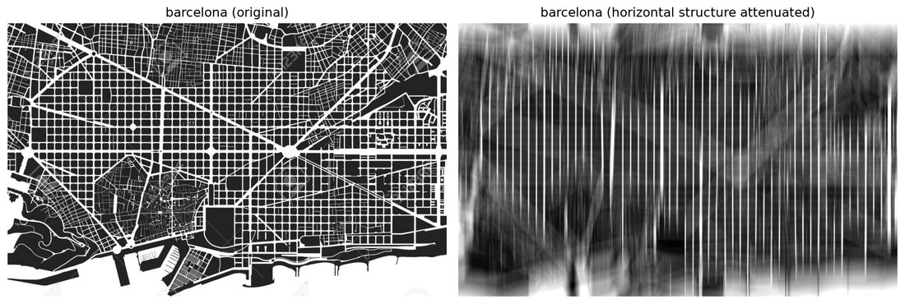

# Fourier Signal & Image Analysis

Periodic structure in time series and images is often clearer in the frequency
domain than in the original coordinates. This project applies the discrete
Fourier transform to two related problems:

1. **Recover the dominant frequency** of a uniformly sampled 1D signal from
   its DFT magnitude spectrum.
2. **Interpret and filter spatial frequencies** in 2D images — in particular,
   attenuate the horizontal street pattern of a city map by suppressing the
   corresponding low vertical frequencies.

| Layer | Role |
| --- | --- |
| `src/fourier_analysis` | Transforms, filters, and analysis pipelines |
| `examples/` | Runnable 1D and 2D analyses |
| `data/` | Sample signal and images |
| `docs/` | Theory, numerical layout, and result figures |

## Results

### 1. Dominant frequency of a sampled signal

A two-column time series $(t, f(t))$ is transformed with the discrete Fourier
transform

$$
Z[k] = \sum_{n=0}^{N-1} z[n]\, e^{-2\pi i\, nk / N}.
$$

The reported frequency is the peak of $\lvert Z[k]\rvert$ on the DFT grid
$f_k = k / (N\Delta t)$, excluding the DC bin.



The left panel is a nearly pure oscillation in time: a
cosine-like waveform with amplitude in $[-1, 1]$ and roughly four cycles over
$\Delta T \approx 0.03$, which already suggests $f \sim 130$. The right panel
is the same information in the frequency domain. Because $f(t)$ is real, the
DFT magnitude is even, so conjugate peaks appear at $\pm f^\star$. Away from
those lines the spectrum is essentially flat, which means there is no
measurable broadband noise or secondary harmonic — the time series is a single
tone. The marker $f^\star = 137$ is the positive-frequency bin of maximum
$\lvert Z(f)\rvert$; it is the physical oscillation rate recovered from the
samples.

```bash
python examples/analyze_1d_signal.py
```

### 2. Spatial spectra of images

Four grayscale inputs — city maps and geometric patterns — are transformed with
the 2D FFT. Spectra are shown as DC-centered log-magnitude

$$
\log\bigl(\lvert F(u, v)\rvert + \varepsilon\bigr)
$$

after `fftshift`, so zero frequency sits in the middle of each panel.



The inputs span two kinds of spatial structure. Barcelona
and Paris are line drawings of street networks: intensity is sparse and
anisotropic (preferred orientations). The fractal and triangle fields are
filled patterns: the fractal is irregular but statistically self-similar; the
triangles form a nearly crystalline lattice. These differences set what the
Fourier plane should look like: directional lines map to directional streaks,
while a periodic tiling maps to a discrete Bragg-like lattice of peaks.



Brightness here is spectral energy, not image intensity.
In every panel the center is the DC component (mean gray level). Barcelona
shows a strong horizontal–vertical cross plus fainter radial spokes: the
orthogonal Eixample grid puts energy along $f_x = 0$ and $f_y = 0$, while
diagonal avenues produce the angled rays. Paris is more diffuse, with a
diagonal X rather than a square cross — consistent with radial boulevards
instead of a single cartesian lattice. The fractal spectrum is a soft central
glow without sharp lines, as expected when power is spread across scales
rather than locked to a few periods. The triangle field collapses to a
hexagonal lattice of bright spots: a periodic real-space tiling whose Fourier
transform is a discrete dual lattice of spatial frequencies.



Each curve is
$\log(\lvert F\rvert + \varepsilon)$ along the horizontal line through DC
($f_y \approx 0$). The central spike is the mean intensity. Barcelona’s cut
is spiked at regular intervals: harmonics of the street spacing appear as
discrete peaks on top of a falling envelope. Paris keeps a similar envelope
but without those sharp harmonics — its plan is less strictly periodic along
that axis. The fractal cut decays smoothly away from DC, close to a power-law
tail. The triangle cut is almost impulsive: a few narrow peaks and a very low
floor, the 1D fingerprint of a highly periodic pattern. Together, the cuts
quantify what the 2D spectra show qualitatively — order versus isotropy in
$f_x$.

### 3. Attenuating horizontal structure on the Barcelona map

Dense east–west streets concentrate energy near low vertical frequencies. A
vertical high-pass kernel

$$
K(x) = 1 - e^{-C x^{2}}
$$

is applied in the Fourier domain,

$$
G = \mathcal{F}^{-1}\{ \mathcal{F}\{K\} \cdot F \},
$$

which reduces that street pattern while preserving components supported on
other orientations.



The left panel is the original map: the Eixample’s
horizontal streets are continuous white lines across blocks. After the
frequency-domain filter (right), those east–west lines are strongly
suppressed and the remaining energy is dominated by vertical and diagonal
structure, which appears as vertical streaks and blurred remnants of the
grid. That is the expected spatial signature of removing spectral content
near $f_y = 0$: features that vary slowly in $y$ (horizontal lines) are
attenuated, while features that oscillate in $y$ (vertical streets) survive.
The before/after pair is therefore a direct check that the filter acts on the
intended physical frequencies, not an arbitrary blur.

```bash
python examples/analyze_2d_images.py
```

Figures regenerate under `outputs/`; the panels above are stored in
`docs/figures/`.

## Setup

```bash
python -m venv .venv
source .venv/bin/activate   # Windows: .venv\Scripts\activate
pip install -r requirements.txt
pip install -e .
```

Requires Python 3.10+.

## Project layout

```text
├── src/fourier_analysis/   # numerical library
├── examples/               # 1D and 2D entry points
├── data/signals/           # sampled 1D series
├── data/images/            # input imagery
├── docs/theory.md          # transform and filter definitions
├── docs/architecture.md    # module layout
├── docs/figures/           # result figures
└── tests/                  # numerical checks
```

## Tests

```bash
pytest
```

The 1D DFT is compared against `numpy.fft.fft` on a known sinusoid; frequency
estimation recovers a planted tone within half a bin. Continuous integration
runs the same suite on Python 3.10 and 3.12.

## Documentation

- [Mathematical background](docs/theory.md) — DFT definition, 2D spectrum
  display, and the high-pass filter used on Barcelona.
- [Architecture](docs/architecture.md) — how the numerical pieces are split.

## Stack

NumPy, Matplotlib, Pillow. The 1D transform is built from the DFT definition
as a dense kernel matrix; 2D spectra and filtering use NumPy’s FFT.
